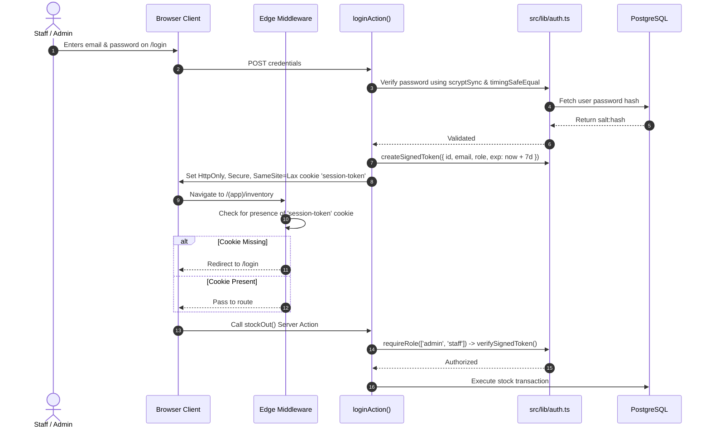

# 02. System Architecture & Technical Specifications

**Target Platform:** Next.js 16 (App Router), React 19, TypeScript 5, Tailwind CSS v4, Prisma 5, PostgreSQL 16  
**Hosting Target:** Ubuntu 24.04 LTS VPS behind Nginx Reverse Proxy & Docker Compose  

---

## 1. Hosting Architecture & Process Manager Decision

**Selected Process Manager:** **Docker Compose (App + PostgreSQL)**  
**Justification (3 lines):**  
1. Bundles Next.js and PostgreSQL 16 into reproducible, isolated containers, completely eliminating host Node.js/Postgres version mismatches on Ubuntu.  
2. Facilitates single-command deployments (`docker compose up -d --build`) and instant rollbacks via pinned Docker images.  
3. Keeps database network traffic on an internal Docker bridge network while Nginx on the host terminates SSL and proxies port 3000.  

---

## 2. Route Map & Directory Layout

### Route Table
```
/                         -> (Redirects to /login or /dashboard based on session)
/login                    -> Standalone Login Screen (Plain form, credentials check, session issue)
/(app)/layout.tsx         -> AppShell (Persistent Sidebar, Header with User/Logout, Breadcrumbs)
  ├── /dashboard          -> src/app/(app)/dashboard/page.tsx
  ├── /inventory          -> src/app/(app)/inventory/page.tsx
  ├── /products           -> src/app/(app)/products/page.tsx (Admin only)
  ├── /stock-operations   -> src/app/(app)/stock-operations/page.tsx
  ├── /quick-scan         -> src/app/(app)/quick-scan/page.tsx
  ├── /defective          -> src/app/(app)/defective/page.tsx
  ├── /low-stock          -> src/app/(app)/low-stock/page.tsx
  ├── /barcodes           -> src/app/(app)/barcodes/page.tsx
  ├── /audit              -> src/app/(app)/audit/page.tsx (Admin only)
  ├── /sku-engine         -> src/app/(app)/sku-engine/page.tsx
  ├── /reports            -> src/app/(app)/reports/page.tsx (Admin only)
  ├── /users              -> src/app/(app)/users/page.tsx (Admin only)
  ├── /settings           -> src/app/(app)/settings/page.tsx (Admin only)
  ├── /activity-logs      -> src/app/(app)/activity-logs/page.tsx (Admin only)
  └── /migration          -> src/app/(app)/migration/page.tsx (Admin only)
```

### Clean Folder Structure
```
Atulglassagency-ERP/
├── docs/                             # Architecture, specs & runbooks
├── prisma/
│   ├── schema.prisma                 # PostgreSQL schema
│   ├── migrations/                   # Baseline migration
│   └── seed.ts                       # Seed with XYG BL catalog & admin users
├── src/
│   ├── app/
│   │   ├── (app)/                    # Protected App Route Group
│   │   │   ├── layout.tsx            # AppShell (Sidebar + Header + Breadcrumb)
│   │   │   ├── dashboard/page.tsx    # 3-line wrapper rendering <Dashboard />
│   │   │   └── ...                   # Route pages
│   │   ├── login/page.tsx            # Clean login form
│   │   ├── layout.tsx                # Root HTML/Body
│   │   └── globals.css               # Utilitarian business styles
│   ├── actions/                      # Server Actions (Auth protected via requireRole)
│   │   ├── auth.ts                   # Login, logout, session check
│   │   ├── products.ts               # Product CRUD
│   │   ├── inventory.ts              # Delegates mutations to src/lib/stock.ts
│   │   ├── defective.ts              # Delegates mutations to src/lib/stock.ts
│   │   └── audit.ts                  # Cycle counts & reconciliation
│   ├── components/
│   │   ├── AppShell.tsx              # Sidebar, Header, Breadcrumbs, User Info
│   │   ├── pictograms/               # Simple SVG glass position pictograms
│   │   └── ui/                       # Table, Modal, Badge, Button, Input
│   ├── hooks/
│   │   └── useScannerWedge.ts        # Keyboard-wedge scanner listener (~40 lines)
│   ├── lib/
│   │   ├── prisma.ts                 # Prisma Client singleton
│   │   ├── auth.ts                   # Token crypto, timingSafeEqual, session cookie
│   │   ├── stock.ts                  # Single source of truth for all stock mutations
│   │   ├── sku.ts                    # SKU generator function
│   │   └── printer/
│   │       ├── types.ts              # PrintAdapter interface (~15 lines)
│   │       └── browser-adapter.ts    # Browser @page CSS print implementation
│   └── views/                        # Cleaned-up business views (reused from base)
```

---

## 3. Stock Mutation Architecture (`src/lib/stock.ts`)

All inventory quantity changes are strictly channeled through `src/lib/stock.ts`. No other module or action touches inventory counts directly.

### Operational Principles:
1. Every stock change runs in an atomic `prisma.$transaction`.
2. Quantity decrement uses a **conditional atomic SQL update**:
   ```typescript
   const result = await tx.inventory.updateMany({
     where: {
       productId,
       goodQty: { gte: quantity }
     },
     data: {
       goodQty: { decrement: quantity }
     }
   });
   if (result.count !== 1) {
     throw new Error(`Insufficient stock for product ${productId}. Operation aborted.`);
   }
   ```
3. A corresponding `Ledger` record is committed in the same transaction.
4. `availableQty` is never stored. In query mappers, it is derived:
   `availableQty = goodQty - reservedQty`.

### Core Stock Operations in `src/lib/stock.ts`:
- `receiveStock(productId, qty, vendor, remarks, tx)`: Increments `goodQty`, writes `Ledger(type: 'IN')`.
- `issueStock(productId, qty, customer, reason, remarks, tx)`: Conditional atomic decrement of `goodQty`, writes `Ledger(type: 'OUT')`.
- `quarantineDefective(productId, qty, reason, user, tx)`: Decrements `goodQty`, increments `defectiveQty`, creates `Defective(status: 'pending')`, writes `Ledger(type: 'DEFECTIVE_MARK')`.
- `scrapDefective(defectiveId, user, tx)`: Decrements `defectiveQty`, updates `Defective(status: 'scrapped')`, writes `Ledger(type: 'DEFECTIVE_SCRAP')`.
- `restoreDefective(defectiveId, qty, user, tx)`: Decrements `defectiveQty`, increments `goodQty`, updates `Defective(status: 'restored')`, writes `Ledger(type: 'DEFECTIVE_RESTORE')`.
- `reconcileAuditAdjustment(productId, deltaQty, sessionName, user, tx)`: Directly adjusts `goodQty` to match physical count and writes `Ledger(type: 'AUDIT_ADJUST')`.

---

## 4. Hardware Scanner Hook (`src/hooks/useScannerWedge.ts`)

A lean, robust hook (~40 lines) to capture fast keystroke bursts from USB and Bluetooth barcode scanners without requiring input focus:

```typescript
import { useEffect, useRef } from 'react';

interface ScannerWedgeOptions {
  onScan: (scannedText: string) => void;
  minChars?: number;
  maxIntervalMs?: number;
}

export function useScannerWedge({
  onScan,
  minChars = 4,
  maxIntervalMs = 50
}: ScannerWedgeOptions) {
  const bufferRef = useRef<string>('');
  const lastKeyTimeRef = useRef<number>(0);

  useEffect(() => {
    const handleKeyDown = (e: KeyboardEvent) => {
      // Ignore if user is typing into an active text input, textarea, or editable element
      const activeTag = (document.activeElement?.tagName || '').toLowerCase();
      const isInput = activeTag === 'input' || activeTag === 'textarea' || (document.activeElement as HTMLElement)?.isContentEditable;
      if (isInput) return;

      const now = Date.now();
      const interval = now - lastKeyTimeRef.current;
      lastKeyTimeRef.current = now;

      if (e.key === 'Enter') {
        if (bufferRef.current.length >= minChars) {
          e.preventDefault();
          onScan(bufferRef.current.trim());
        }
        bufferRef.current = '';
        return;
      }

      // If keystrokes are slower than 50ms, it is a human typist: reset buffer
      if (interval > maxIntervalMs) {
        bufferRef.current = '';
      }

      if (e.key.length === 1) {
        bufferRef.current += e.key;
      }
    };

    window.addEventListener('keydown', handleKeyDown);
    return () => window.removeEventListener('keydown', handleKeyDown);
  }, [onScan, minChars, maxIntervalMs]);
}
```

---

## 5. Label Printing Adapter Architecture (`src/lib/printer/`)

Per the fixed decision, the cloud VPS has no physical LAN printer access. Printing is abstracted behind a clean interface with a default browser-print implementation:

### Interface (`src/lib/printer/types.ts` ~15 lines):
```typescript
export interface LabelData {
  sku: string;
  brand: string;
  carBrand: string;
  carModel: string;
  glassType: string;
  barcode: string;
  date: string;
}

export interface PrintAdapter {
  name: string;
  isAvailable(): boolean;
  printLabel(label: LabelData, layout: '50x25' | '75x50'): Promise<{ success: boolean; error?: string }>;
}
```

### Default Implementation (`src/lib/printer/browser-adapter.ts`):
Renders the label inside an invisible iframe or triggers `window.print()` with CSS `@page` constraints:
```css
@media print {
  @page {
    size: 50mm 25mm; /* or 75mm 50mm */
    margin: 0;
  }
  body * { visibility: hidden; }
  .printable-label, .printable-label * { visibility: visible; }
  .printable-label { position: absolute; left: 0; top: 0; width: 100%; height: 100%; }
}
```
Settings page displays a clean, static block:  
**Hardware Status:** `Printer: not configured`

---

## 6. Authentication & Security Flow



### Security Fixes Applied:
1. **Token Expiry:** `createSignedToken` embeds `exp: Math.floor(Date.now() / 1000) + (7 * 86400)`. `verifySignedToken` rejects expired tokens.
2. **Edge Middleware Safety:** Middleware only checks whether `session-token` cookie exists. It does not run Node crypto in the Edge runtime.
3. **Server Action Authorization:** Real authorization is enforced inside Server Actions using `requireRole(['admin', ...])` which cryptographically validates the token HMAC signature.
4. **Login Throttling:** An in-memory sliding window rate limiter restricts failed login attempts to a maximum of 5 attempts per 15 minutes per IP.
5. **Secure Cookie Flags:** `httpOnly: true`, `sameSite: 'lax'`, `secure: process.env.NODE_ENV === 'production'`.

---

## 7. What We Deliberately Do Not Build (Anti-Bloat Guardrail)

1. **No External Connection Proxies:** No PgBouncer, no Prisma Accelerate. Standard PostgreSQL connection pool via `@prisma/client` handles concurrency.
2. **No Hardware Drivers:** No ZPL, TSPL, or ESC/POS code.
3. **No Pricing or Invoicing Engines:** No GST, ledger debit/credit balances, invoice generation, or payment tracking.
4. **No Server Component Rewrites for Views:** Existing 15 views remain functional client components rendered cleanly by route `page.tsx` files.
5. **No Animations or Dark Mode:** No `framer-motion` overhead; pure high-contrast business styling.
